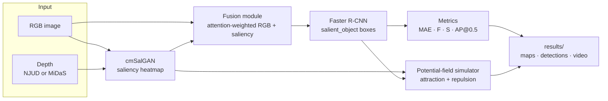
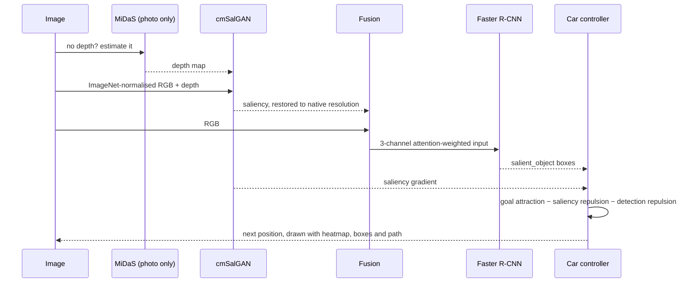

# Saliency-Aware Autonomous Driving
<p align="center">
  <a href="Saliency-Maps%20Demo.mp4">
    
  </a>
  <br>
  <sub>▶ <b><a href="Saliency-Maps%20Demo.mp4">Watch the Saliency-Maps demo</a></b> (90 s): a fresh clone running the Gradio demo on real photos (depth, saliency, detections and a simulated car), with the README's numbers checked against a re-run</sub>
</p>


**An end-to-end vision pipeline — RGB-D saliency, saliency-guided fusion, Faster R-CNN detection and potential-field navigation — with an ablation that reports where the idea does not pay.**

[](.github/workflows)
[](pyproject.toml)
[](saliency_driving/train.py)
[](saliency_driving/simulation)
[](app.py)
[](LICENSE)

cmSalGAN turns RGB + depth into a saliency heatmap, a fusion module feeds RGB and
saliency to a Faster R-CNN detector, and a simulated car steers through the scene
by potential-field control. It runs on the bundled RGB-D sample and, through
MiDaS monocular depth, on any ordinary photo.

<p align="center">
  <br>
  <em>Simulated car (white) steering through a scene — saliency heatmap, detections,
  path trace (orange), and goal (magenta). <code>python main.py --simulate</code></em>
</p>

---

## Contents

| Section | |
|---|---|
| [What it does](#what-it-does) | The pipeline and its tooling, by area |
| [Architecture](#architecture) | Saliency, fusion, detection, evaluation, simulation |
| [How a frame is processed](#how-a-frame-is-processed) | Image in, steering out |
| [Quick start](#quick-start) | Install, run a stage, run on a photo |
| [Results](#results) | Saliency metrics and the detection ablation |
| [Project status](#project-status) | What CI proves, and the next steps |
| [Design decisions](#design-decisions) | The tradeoffs, and why |
| [Repository layout](#repository-layout) | Where things live |
| [Documentation](#documentation) | Which file answers which question |
| [Team](#team) | Who built it |

---

## What it does

| Area | Capabilities |
|---|---|
| **Saliency** | cmSalGAN from RGB + depth, saved at original resolution; a labelled spectral-residual fallback without the checkpoint |
| **Depth** | MiDaS monocular depth, so any photo works (`main.py --infer photo.jpg`) |
| **Fusion** | Attention-weighted RGB + saliency into a 3-channel detector input, trained jointly with the detector |
| **Detection** | Faster R-CNN over background / `salient_object`, supervised by boxes derived from ground-truth saliency masks |
| **Metrics** | Saliency MAE, F-measure, S-measure; detection AP@0.5, precision, recall, F1; measured inference time |
| **Ablation** | Baseline, plain fusion and attention fusion trained under identical seeds, with a comparison table |
| **Explainability** | Fusion attention maps and EigenCAM over the detector backbone |
| **Simulation** | A point-mass car steered per frame by goal attraction and saliency/detection repulsion, rendered to video |
| **Demo** | A Gradio app deployable to Hugging Face Spaces |

---

## Architecture



Everything is driven by `config.yaml`, logged and seeded.

---

## How a frame is processed



---

## Quick start

> The pretrained cmSalGAN checkpoint and the full dataset come from
> `python scripts/download_data.py --what model|dataset` (needs `gdown`).

```bash
# 1 — install
git clone https://github.com/guru-bharadwaj20/Saliency-Maps.git && cd Saliency-Maps
pip install -r requirements.txt            # runtime
pip install -r requirements-dev.txt        # + pytest, ruff, black

# 2 — the whole pipeline on the bundled NJUD sample, or one stage at a time
python main.py --all                       # saliency → train → test → simulate
python main.py --saliency | --train | --test | --simulate

# 3 — any photo, no RGB-D needed
pip install timm
python main.py --infer path/to/photo.jpg   # → results/single/

# 4 — the web demo
pip install gradio timm && python app.py   # http://127.0.0.1:7860
```

---

## Results

Measured on the bundled 10-image NJUD sample (CPU, seed 42) — honest
small-sample numbers, not benchmarks.

**Saliency** (cmSalGAN vs ground-truth masks): MAE **0.265**, F-measure
**0.554**, S-measure **0.630**.

**Detection ablation** (`python scripts/run_ablation.py`) — same COCO-pretrained
Faster R-CNN, 3 epochs, identical seed. "Oracle" feeds the ground-truth mask as
saliency, to isolate the fusion architecture from cmSalGAN's quality.

| Variant | Fusion | Saliency input | AP@0.5 | Precision | Recall | F1 |
|---|---|---|---:|---:|---:|---:|
| **baseline_no_fusion** | none | — | **0.584** | 0.389 | **0.700** | **0.500** |
| fusion_plain | conv only | oracle (GT) | 0.300 | 0.385 | 0.500 | 0.435 |
| fusion_attention | conv + attention | oracle (GT) | 0.393 | 0.182 | 0.600 | 0.279 |
| fusion_attention | conv + attention | cmSalGAN maps | 0.309 | 0.147 | 0.500 | 0.227 |

**At this scale the raw-RGB baseline wins.** The randomly initialised fusion
front end disrupts the input statistics the pretrained backbone expects, and
10 images × 3 epochs is far too little to recover. Explainability makes it
visible: the baseline's EigenCAM focuses on the salient objects, while the fusion
module's attention stays nearly uniform and its EigenCAM drifts to the borders.

<p align="center">
  
</p>

---

## Project status

The pipeline, ablation harness, explainability and demo are complete. The
natural follow-ups are one-liners in the harness:
`python scripts/run_ablation.py --epochs N --saliency-source precomputed`.

| Next | Why |
|---|---|
| The full NJUD dataset | 10 images cannot separate the variants |
| Identity-initialised fusion | Start from the baseline's input statistics instead of disrupting them |
| Longer schedules | Give the fusion front end time to learn |

### What CI proves on every push

| Step | Proves |
|---|---|
| `ruff check .` | Lint is clean |
| `pytest -m "not slow"` | Metrics, datasets, fusion, simulation and config units pass |

`pytest -m slow` additionally runs one full training step through the real
pipeline.

---

## Design decisions

**Boxes from masks.** The dataset has saliency masks, not boxes, so detector
supervision comes from connected components of the ground-truth masks — no extra
labelling.

**An oracle row in the ablation.** Feeding ground-truth saliency separates "the
fusion design is wrong" from "the saliency predictor is weak". Here the fusion
design loses even with perfect saliency.

**Report the negative result.** The baseline beats every fusion variant at this
scale, and the README leads with that rather than with the variant that was
expected to win.

**One checkpoint, two modules.** The fusion module is trained jointly with the
detector and reloaded from the same checkpoint, so inference cannot pair
mismatched weights.

**Depth should not be a prerequisite.** MiDaS removes the RGB-D requirement, and
without a cmSalGAN checkpoint the saliency stage falls back to a clearly labelled
spectral-residual method instead of failing.

---

## Repository layout

```
.
├── saliency_driving/
│   ├── config.py · log.py      configuration, logging, seeding
│   ├── datasets.py             RGB-D dataset
│   ├── annotations.py          ground-truth mask → bounding boxes
│   ├── fusion.py               RGB + saliency fusion module
│   ├── metrics.py              saliency and detection metrics
│   ├── train.py · evaluate.py  detector training and evaluation
│   ├── pipeline.py             single-image end-to-end inference
│   ├── models/                 cmSalGAN + ResNet backbone
│   ├── saliency/               generation, MiDaS depth, heuristic fallback
│   └── simulation/             simulator, obstacle avoidance, visualisation
├── scripts/                    download_data, run_ablation, make_demo_gif, make_explainability
├── tests/                      pytest suite
├── data/ · docs/ · models/     sample dataset, figures, checkpoints
├── main.py                     CLI: pipeline stages and --infer
├── app.py                      Gradio web demo
└── config.yaml                 paths and hyperparameters
```

---

## Documentation

| Question | File |
|---|---|
| *How do I publish the demo?* | [docs/DEPLOY_HF_SPACES.md](docs/DEPLOY_HF_SPACES.md) |
| *Which paths and hyperparameters apply?* | [config.yaml](config.yaml) |
| *How is the ablation run?* | [scripts/run_ablation.py](scripts/run_ablation.py) |

---

## Team

| Member | Focus |
|---|---|
| **Guru R Bharadwaj** | Pipeline, fusion and detection, ablation, simulation, demo |

---

## License

[MIT](LICENSE).
