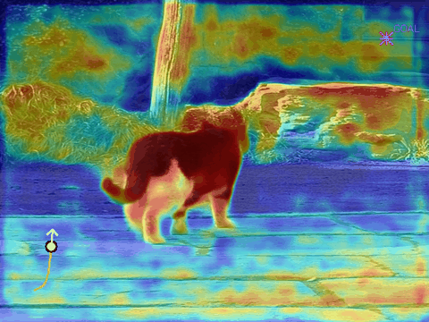
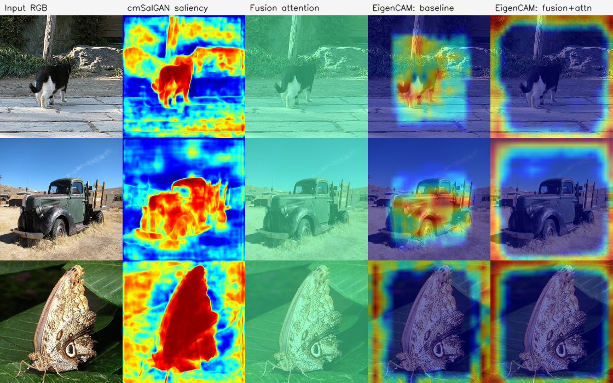

# Saliency-Aware Autonomous Driving

An end-to-end vision pipeline that combines **RGB-D saliency detection** (cmSalGAN),
**saliency-guided fusion**, **Faster R-CNN object detection**, and **potential-field
navigation** into a single system. It runs on the bundled RGB-D dataset and, via
monocular depth estimation, on any ordinary photo. Built with PyTorch and OpenCV.

<p align="center">
  <br>
  <em>Simulated car (white) steering through a scene — saliency heatmap, detections,
  path trace (orange), and goal (magenta). <code>python main.py --simulate</code></em>
</p>

## Highlights

- **cmSalGAN saliency** from RGB + depth, saved at original resolution.
- **Fusion module** (attention-weighted RGB + saliency) trained jointly with the detector and reloaded from the same checkpoint.
- **Detector supervision without box labels** — bounding boxes are derived from the ground-truth saliency masks via connected components.
- **Real metrics**, not placeholders — saliency: MAE / F-measure / S-measure; detection: AP@0.5, precision / recall / F1; measured inference time.
- **Ablation harness** that trains baseline / fusion / attention variants under identical seeds and reports a comparison table.
- **Runs on any image** — MiDaS monocular depth removes the RGB-D requirement (`main.py --infer photo.jpg`); a Gradio web demo (`app.py`) is deployable to Hugging Face Spaces.
- **Explainability** — fusion attention maps and EigenCAM visualizations of the detector backbone.
- Config-driven (`config.yaml`), logged, seeded, tested (`pytest`), and linted (`ruff`) with CI.

## Quickstart

```bash
git clone https://github.com/guru-bharadwaj20/saliency-aware-autonomous-driving.git
cd saliency-aware-autonomous-driving
pip install -r requirements.txt          # runtime
pip install -r requirements-dev.txt      # + pytest, ruff, black
```

Run the full pipeline on the bundled NJUD sample, or any single stage:

```bash
python main.py --all                     # saliency → train → test → simulate
python main.py --saliency                # generate saliency maps (needs cmSalGAN ckpt)
python main.py --train                   # train detector + fusion
python main.py --test                    # inference + metrics + predictions JSON
python main.py --simulate                # car simulation + .avi video
```

Run on your own image (no RGB-D data needed):

```bash
pip install timm                         # MiDaS monocular depth
python main.py --infer path/to/photo.jpg # → results/single/
```

Interactive web demo:

```bash
pip install gradio timm
python app.py                            # http://127.0.0.1:7860
```

See [docs/DEPLOY_HF_SPACES.md](docs/DEPLOY_HF_SPACES.md) to publish the demo.
The pretrained cmSalGAN checkpoint and full dataset are fetched with
`python scripts/download_data.py --what model|dataset` (requires `gdown`);
without the checkpoint, saliency falls back to a labeled spectral-residual method.

## Pipeline

1. **Saliency** — cmSalGAN maps RGB + depth to a heatmap (ImageNet-normalized input, restored to native resolution).
2. **Fusion** — RGB and saliency are fused into a 3-channel, attention-weighted detector input.
3. **Detection** — Faster R-CNN over two classes (background / `salient_object`), supervised by GT-mask-derived boxes.
4. **Evaluation** — saliency and detection metrics against ground truth; predictions saved to `results/detection_outputs/`.
5. **Simulation** — a point-mass car is steered per frame by potential-field control (goal attraction + saliency-gradient and detection repulsion) and rendered to a video.

## Results

Measured on the bundled 10-image NJUD sample (CPU, seed 42) — honest small-sample
numbers, not benchmarks.

**Saliency** (cmSalGAN maps vs. GT masks): MAE **0.265**, F-measure **0.554**, S-measure **0.630**.

**Detection ablation** (`python scripts/run_ablation.py`) — same COCO-pretrained
Faster R-CNN, 3 epochs, identical seed. "Oracle" uses the GT mask as saliency input
to isolate the fusion architecture from cmSalGAN's prediction quality.

| Variant | Fusion | Saliency input | AP@0.5 | Precision | Recall | F1 |
|---|---|---|---|---|---|---|
| **baseline_no_fusion** | none | — | **0.584** | 0.389 | **0.700** | **0.500** |
| fusion_plain | conv only | oracle (GT) | 0.300 | 0.385 | 0.500 | 0.435 |
| fusion_attention | conv + attention | oracle (GT) | 0.393 | 0.182 | 0.600 | 0.279 |
| fusion_attention | conv + attention | cmSalGAN maps | 0.309 | 0.147 | 0.500 | 0.227 |

At this scale the raw-RGB baseline wins: the randomly-initialized fusion frontend
disrupts the input statistics the pretrained backbone expects, and 10 images × 3
epochs is far too little to recover. The harness makes the natural follow-ups
one-liners (full dataset, identity-initialized fusion, longer schedules):
`python scripts/run_ablation.py --epochs N --saliency-source precomputed`.

**Explainability** (`python scripts/make_explainability.py`) makes this visible — the
baseline's EigenCAM focuses on the salient objects, while the fusion module's learned
attention stays nearly uniform and its EigenCAM drifts to the image borders.

<p align="center">
  
</p>

## Project structure

```
saliency_driving/          # library package
├── config.py, log.py      # config, logging, seeding
├── datasets.py            # RGB-D dataset
├── annotations.py         # GT mask → bounding boxes
├── fusion.py              # RGB + saliency fusion module
├── metrics.py             # saliency + detection metrics
├── train.py, evaluate.py  # detector training / evaluation
├── pipeline.py            # single-image end-to-end inference
├── models/                # cmSalGAN + ResNet backbone
├── saliency/              # generation, MiDaS depth, heuristic fallback
└── simulation/            # simulator, obstacle avoidance, visualization
scripts/                   # download_data, run_ablation, make_demo_gif, make_explainability
tests/                     # pytest suite
data/, docs/, models/      # sample dataset, figures, checkpoints
main.py                    # CLI (pipeline stages + --infer)
app.py                     # Gradio web demo
config.yaml                # paths + hyperparameters
```

## Testing

```bash
pytest -m "not slow"   # fast unit suite (metrics, datasets, fusion, simulation, config)
pytest -m slow         # + one full training step through the real pipeline
ruff check .           # lint
```

GitHub Actions runs the lint and fast suite on every push and pull request.

## License

MIT — see [LICENSE](LICENSE).
